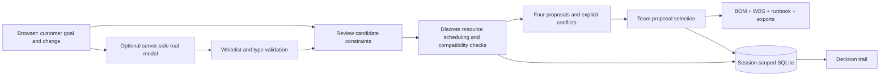

# DemoShift

**Keep the customer promise in view when a robotics demonstration changes.**

DemoShift turns an equipment delay or changed constraint into a consistent operating proposal: resource-constrained schedule, equipment list, work breakdown and demonstration runbook. It is built for the solutions lead who must explain what the team can still demonstrate, by when, and at what additional recovery cost.

All included customers, people, catalog items, prices and task estimates are synthetic. No employer code, customer records, private memory or internal robotics documentation is included.

## Run

Python 3.11 or newer; no third-party packages.

```sh
python server.py --host 127.0.0.1 --port 8881
```

Open `http://127.0.0.1:8881/`. The default SQLite file is `data/demoshift.sqlite3`.

```sh
python server.py --host 0.0.0.0 --port 8881 --data-dir /data
python -m unittest -v test_demoshift
node --check static/app.js
```

The Node check is optional development validation; Node is not needed to run the application. `--db /absolute/file.sqlite3` overrides `--data-dir`. `DATA_DIR` supplies the default data directory.

## A complete operational workflow

1. Inspect the customer's original 3D localization and barcode demonstration goal.
2. Submit a natural-language change to a **configured real model**, or edit the declared constraints directly.
3. Review the candidate constraint patch. A model response does not change or approve the plan.
4. Recompute four alternatives against task dependencies, named people, equipment release dates, declared payload limits, camera interfaces, scope and recovery budget.
5. Inspect actual working-time schedules, the bill of materials, additional cost and runbook. Infeasible plans remain visible with their blocking constraints and cannot be selected.
6. Select an operating proposal and export the same saved revision as Markdown or JSON.
7. Change another constraint. The current selection clears and the decision trail retains the prior context.

Selecting a reduced scope or a later customer date records **a team proposal with customer sign-off still outstanding**. It never records actual customer acceptance. No equipment is ordered and no physical robot is controlled.

## Reproducible sample

The “Camera delayed to day 5” scenario keeps the requested demonstration at day 7, a 2 kg workpiece, a $1,500 recovery budget and an available integration engineer.

- Contracted camera: finishes day **8.5** and violates the requested day-7 deadline.
- Compatible 3D rental with gateway: finishes day **5.5**, preserves the requested scope, and adds **$1,380** in declared rental, gateway and configuration estimates.
- Existing 2D camera: finishes day **4.5**, with the 3D requirement deferred and **customer scope agreement required**.
- Original camera with a new demonstration date: finishes day **8.5**, proposing day **9** for customer agreement.

The unchanged original plan finishes on working day **5**. Disabling the interface gateway blocks the rental option. Exceeding the gripper's 5 kg declared limit blocks every camera option. These are computed outcomes of the synthetic model, not measured robot performance or demonstrated business savings.

## AI connection

The server supports an OpenAI-compatible chat endpoint through:

```sh
AI_BASE_URL=http://127.0.0.1:11434/v1
AI_MODEL=llama3.2:3b
# AI_API_KEY is optional for a local bridge; keep real provider keys server-side.
```

Set the variables using the shell or your service manager before starting `server.py`. The local model must actually be installed and running. HTTP is permitted only on loopback; remote endpoints require HTTPS. In a container, a loopback bridge must be supplied by the deployment owner, or the endpoint must use HTTPS.

The model is asked to extract a candidate patch from a fixed whitelist of supported constraints. Unknown cameras, resources, tasks, fields, invalid types, unsupported values and malformed JSON are rejected. Every proposed field needs a verbatim source quote. A conservative field-specific parser checks that explicit day numbers, weight and budget are preserved; “camera ready on day 5” cannot become day 4 or borrow day 7 from the demonstration date. Ambiguous or unsupported phrasing is rejected with a manual-edit path. No model-proposed constraint is adopted until the user reviews it. Model response text, actual returned model name, token usage when provided, and latency are saved with the session's proposal. Missing providers, invalid output and network errors produce an explicit error; the service does not synthesize a successful model response.

The planner independently recomputes every option after the reviewed changes are adopted. An AI explanation cannot override a schedule, budget or compatibility failure.

### Integration evidence boundary

The repository includes provider-contract tests that use an explicitly labelled fixture response. These tests validate parsing and rejection, not live model quality. Successful live-model evidence, the actual deployed infrastructure and the final public demo URL must be recorded separately by the deployment operator. A local or owner-hosted deployment does **not** establish the Vultr VM requirement.

## Scheduling model

One slot is four working hours; two slots form one working day. Night and weekend calendar time is not represented. Tasks have fixed durations, explicit predecessor IDs, required named people and optional equipment release slots. A person cannot be assigned to overlapping tasks. A task runs for consecutive **working** slots and can cross a workday boundary.

For this small fixed graph, the solver enumerates topological priority lists, inserts each ready task at its earliest resource-feasible start, and retains the minimum makespan. It can parallelize cell preparation and robot sequence work. It is not a learned schedule and does not estimate actual robot cycle time, electrical compliance, safety performance or physical collision risk. Catalog claims and task durations are declared inputs that need an engineering review before any field use.

## Architecture



## API

- `GET /health`: inexpensive service and AI-configuration status; no session data or credentials.
- `GET /api/state`: creates or restores the browser's isolated state and returns an `analysis_id` for optimistic concurrency.
- `POST /api/replan`: `{"expected_analysis_id":"…","config":{"camera_delay_days":5}}`. Unspecified constraints use the documented default; the UI sends the full current configuration.
- `POST /api/interpret`: `{"expected_analysis_id":"…","brief":"The camera is delayed to day 5."}`. Returns an unadopted model patch; never writes a new operating plan.
- `POST /api/select`: `{"expected_analysis_id":"…","plan_id":"rent"}`. A conditional proposal additionally requires `"acknowledge_customer_approval_needed":true`.
- `GET /api/export?plan=rent`: Markdown operating pack.
- `GET /api/export?plan=rent&format=json`: structured pack and explicit `customer_approval:"not_recorded"`.

State-changing requests require `Content-Type: application/json` and an allowed `Origin`. A stale `analysis_id` returns HTTP 409. Browser requests use relative `api/...` URLs and work behind a prefix-stripping proxy such as `/hackathons/demoshift/`.

## Deployment and session isolation

Configure your public origin, for example:

```sh
DEMO_ALLOWED_ORIGINS=https://example.org
DEMO_COOKIE_SECURE=1
APP_COOKIE_NAME=demoshift_session
DATA_DIR=/data
```

Use a public HTTPS reverse proxy, preserve the public `Origin`, redirect a prefix without its trailing slash, strip the path prefix before proxying, and mount `/data` as a persistent writable volume. Serve only the application port; do not expose an AI bridge publicly. The application code can be mounted read-only.

Sessions use random 256-bit HttpOnly SameSite=Lax cookies. Only hashed session tokens are stored in SQLite, every read/write is scoped to that hash, and stale concurrent actions are rejected. `DEMO_COOKIE_SECURE=1` adds the Secure flag. No cross-origin API access is enabled. The sample has no account system or cross-device sharing; it is a browser-session demonstration, not a production multi-tenant access-control product.

AI requests have a persisted rolling one-hour limit per browser session: `DEMO_AI_CALLS_PER_HOUR=6` by default, configurable from 1 to 60. Failed provider attempts count, so retrying an invalid response cannot bypass the budget. One model request may be in flight application-wide; concurrent requests and exhausted budgets return HTTP 429 with `Retry-After`. These anonymous-session controls complement deployment-level rate limiting and do not constitute authenticated per-person quotas.

## Verification

`python -m unittest -v test_demoshift` currently runs **25 meaningful tests**:

- Baseline, delayed-equipment, missing-equipment, missing-gateway, payload and budget outcomes.
- Dependency ordering, equipment release, people availability and no double-booking across a scenario grid.
- Parallel scheduling, cycle rejection, deterministic replay and consistent exports.
- Independent browser sessions, persistent SQLite state, cookie flags and hashed session storage.
- CSRF origin checks, JSON-only writes, stale updates, rejected infeasible selections and explicit outstanding customer agreement.
- Replanning invalidates the current selection; unknown model fields and absent AI providers do not get silently accepted.
- Explicit source-value grounding rejects off-by-one days, swapped field values, invented quotes and unsupported boolean changes.
- Persisted per-session AI budgets, a single concurrent inference guard and failed-attempt accounting are tested with mock providers, not real model calls.

The suite passed locally on **2026-10-27**. These are code and API checks; browser visual checks, real-model integration, infrastructure verification and video upload are separate evidence.

## Submission checklist

- [x] Independent public-safe synthetic implementation.
- [x] Working web UI, real replanning, SQLite persistence and scoped exports.
- [x] Constraint and HTTP API tests; JavaScript syntax validation.
- [x] English project description and demonstration script.
- [ ] Record a successful real AI request on the deployed service.
- [ ] Deploy and verify the required **Vultr VM** and public web app.
- [ ] Confirm event rules for preparation code, presentation/video duration and registration.
- [ ] Produce the final screen recording, presentation, cover image and public licensed repository.
- [ ] Submit the complete project and verify the actual organizer receipt.

No organizer registration, sponsor approval, Vultr deployment or final submission is claimed by this repository.

## License

MIT. Original implementation with the Python standard library. No competitor code or private project code was copied. Public tools and product descriptions informed the problem review, not a claim of feature uniqueness.

## Hosted review demo

[Open the interactive review demo](https://knowledge.openakashic.com/hackathons/demoshift/)

This is an owner-hosted review deployment using synthetic demonstration data. It is not evidence of deployment on Vultr, execution of an NVIDIA model on Nebius, or a verified PayPal Sandbox round trip. Those event-specific requirements remain separate submission gates, as described above. Repository publication is not contest submission.
